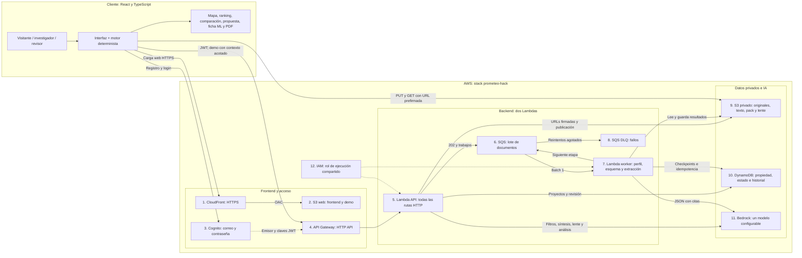

# Prometeo — Arquitectura final del sistema MVP

14 de noviembre de 2026 · Versión de diseño para el hack

## 1. Qué representa esta versión

Esta es la arquitectura final documentada del MVP simplificado. Consolida los casos de uso, el diseño AWS y el recorte para desplegar con menos configuración. Sustituye las decisiones de infraestructura del diseño inicial cuando difieren. El documento de casos de uso conserva sus criterios de aceptación.

**Estado actual comprobado en esta carpeta:** hay documentos Markdown; no hay aplicación, plantilla SAM, manifiestos de dependencias, datos de demo ni pruebas ejecutables. El tablero Miro y este documento describen el sistema que debe implementarse; no acreditan recursos desplegados ni funciones operativas. Los nombres de recursos son lógicos, no nombres obtenidos de una cuenta AWS.

**Decisión principal:** ocho servicios funcionales de AWS, dos funciones Lambda, un rol IAM de ejecución compartido, dos buckets S3, una tabla DynamoDB, una cola SQS y su DLQ. Un ambiente `hack`, un stack `prometeo-hack` y deploy manual con SAM. Sin configuración de CloudWatch.

## 2. Diagrama editable en Miro

[Abrir arquitectura completa en Miro](https://miro.com/app/board/uXjVENlz_Ew=/).

El tablero usa la referencia visual proporcionada: servicios identificables, agrupaciones por responsabilidad, conexiones dirigidas y numeración. No incorpora ECS, Fargate, Amplify, VPC o IoT de la imagen de referencia, porque pertenecen a otro sistema.

- [01. Sistema completo y conexiones](https://miro.com/app/board/uXjVENlz_Ew=/?moveToWidget=3458764690478180599)
- [02. Todas las Lambdas y sus responsabilidades](https://miro.com/app/board/uXjVENlz_Ew=/?moveToWidget=3458764690478252125)
- [03. Cobertura de los 19 casos MVP](https://miro.com/app/board/uXjVENlz_Ew=/?moveToWidget=3458764690478252126)
- [04. Flujo desde documentos hasta informe](https://miro.com/app/board/uXjVENlz_Ew=/?moveToWidget=3458764690478252127)
- [05. Despliegue y decisiones del hack](https://miro.com/app/board/uXjVENlz_Ew=/?moveToWidget=3458764690478252128)

Las flechas continuas representan peticiones o movimiento de datos. Las flechas punteadas representan relaciones de identidad y permisos; no son llamadas de negocio. El nodo Bedrock utiliza un pictograma genérico identificado con su nombre; los servicios con icono AWS se distinguen por sus etiquetas. La numeración identifica componentes, no el orden cronológico del flujo.

## 3. Vista completa reproducible en Markdown



CloudFront es global. API, Lambdas, SQS, tabla, Cognito, almacenamiento y acceso a Bedrock deben configurarse de forma compatible en la región elegida. El diseño original propone `us-east-1`; la región final y el modelo quedan sujetos a una llamada real exitosa en la cuenta. No se ha verificado una cuenta AWS en esta revisión.

## 4. Inventario de componentes

| Nº | Componente lógico | Cantidad | Responsabilidad |
| --- | --- | --- | --- |
| — | Frontend React + TypeScript | 1 aplicación estática | Pantallas, lente, motor, revisión, propuesta, informe y ficha ML. |
| 1 | CloudFront | 1 distribución | HTTPS y caché del frontend/demo; dominio predeterminado. |
| 2 | S3 web | 1 bucket | Build estático, corpus de demo autorizado y pack/lente públicos de demo. Acceso de origen por OAC; sin bucket público directo. |
| 3 | Cognito | 1 user pool + cliente web | Correo/contraseña, verificación, recuperación y emisión de tokens. |
| 4 | API Gateway HTTP API | 1 API | Rutas públicas acotadas de demo y rutas privadas con JWT; límites de peticiones y CORS. |
| 5 | Lambda API | 1 función Python | Router HTTP, autorización por propietario, URLs de carga/lectura, revisión, publicación y asistencia IA. |
| 6 | SQS ingesta | 1 cola | Etapas de un lote cerrado; reintentos y activación del worker. |
| 7 | Lambda worker | 1 función Python | Perfilado, propuesta de esquema, extracción con citas y persistencia de resultados. |
| 8 | SQS DLQ | 1 cola | Mensajes que agotaron reintentos; inspección y recuperación manual. |
| 9 | S3 privado | 1 bucket | Originales, texto, borradores, resultados, packs y lentes por usuario/proyecto. |
| 10 | DynamoDB | 1 tabla bajo demanda | Proyectos, propiedad, intención, documentos, trabajos, checkpoints, historial y propuestas guardadas. |
| 11 | Bedrock | 1 modelo configurado | Extracción, esquema, lente, filtros y redacción; no calcula niveles ni aptitud ML. |
| 12 | IAM | 1 rol de ejecución Lambda | Unión de permisos mínimos de API y worker dentro del stack. |

Los ocho servicios funcionales son S3, CloudFront, Cognito, API Gateway, Lambda, SQS, DynamoDB y Bedrock. IAM añade la autorización. SAM/CloudFormation pertenecen al despliegue, no al recorrido de una petición de usuario.

## 5. Todas las Lambdas

### Lambda API

Una función Python recibe las rutas HTTP de API Gateway. No se crea una función por endpoint. Su configuración inicial propuesta es 512 MB y timeout de 30 segundos, pendiente de medición.

| Método y ruta del diseño original | Función | CU |
| --- | --- | --- |
| `POST /projects` | Crear proyecto e intención. | CU-05 |
| `GET /projects` | Listado mínimo para acceder a proyectos propios. No implica renombrar, duplicar o borrar de CU-03. | CU-02, CU-10 |
| `GET /projects/{id}` | Leer estado y enlaces autorizados del proyecto. | CU-06, CU-10 |
| `POST /projects/{id}/uploads` | Generar URLs prefirmadas para subida directa a S3. | CU-05 |
| `POST /projects/{id}/ingest` | Crear el lote, registrar tareas y encolar procesamiento; responder `202`. | CU-06 |
| `GET /projects/{id}/schema` | Recuperar esquema propuesto, borrador y contexto de revisión. | CU-07 |
| `PUT /projects/{id}/schema` | Guardar decisiones de revisión e historial. | CU-07 |
| `PATCH /projects/{id}/records/{rid}` | Corregir datos o resolver conflictos conservando procedencia. | CU-08 |
| `POST /projects/{id}/publish` | Comprobar aprobación, validar pack, generar/validar lente y publicar versión privada. | CU-07, CU-10 |
| `POST /ask` | Traducir pregunta a filtro o escenario JSON validado. | CU-19 |
| `POST /analysis` | Síntesis/análisis con citas y verificación de afirmaciones. | CU-12, CU-20 |

Esta tabla recoge diseño, no endpoints probados. El diseño original no fija los contratos HTTP para editar intención, reanudar tareas, guardar variantes de propuesta o solicitar la URL del PDF original; esas operaciones son necesarias y deben concretarse dentro de esta misma Lambda, sin agregar servicios. No se inventan rutas operativas para ellas.

Las rutas de proyectos requieren JWT y validación de propietario. La variante pública de asistencia de la demo queda limitada al corpus de demo conocido por el servidor, sin aceptar identificadores privados del cliente. Síntesis y análisis de proyectos propios requieren JWT. Los detalles de payload y la separación explícita del contexto público/privado siguen pendientes de contrato.

La Lambda valida toda salida JSON de IA. La lente inválida usa una lente genérica válida; un fallo de filtro/análisis se muestra con opción de reintento. Si una llamada no cabe en el timeout, informar el fallo o diseñar su ejecución como trabajo persistido antes de cambiar el contrato; no ocultarlo con una respuesta grabada presentada como IA en vivo.

### Lambda worker

Una función Python activada exclusivamente por SQS; no expone una URL pública. Las etapas son tipos de trabajo de esta función, no Lambdas adicionales.

1. **Perfilar:** extraer texto de PDF con texto, perfilar CSV/Excel/texto y guardar resumen por documento.
2. **Inducir esquema:** al completar los perfiles, proponer variables, unidades, rangos y mapeos desde la intención; validar JSON.
3. **Extraer:** recuperar condiciones, resultados, relaciones, huecos y menciones de datasets con documento, página/ubicación y fragmento de respaldo.
4. **Unificar:** vincular registros de la misma prueba, conservar discrepancias como conflictos y registrar conversiones de unidades.
5. **Persistir y avanzar:** guardar resultados y checkpoints, actualizar progreso y coordinar la siguiente etapa. La revisión/aprobación y publicación pertenecen al recorrido humano y la API.

| Parámetro propuesto | Valor inicial |
| --- | --- |
| Memoria / timeout | 1 024 MB / 600 s |
| Batch SQS / ventana | 1 mensaje / 0 s |
| Visibilidad de cola | 3 600 s |
| Máxima concurrencia del event source mapping | 2; sin límite reservado inferior que lo contradiga |
| Política de errores de cola | DLQ tras 5 recepciones |
| Cifrado de cola | SSE-SQS, sin clave KMS propia |

La tarea se identifica por proyecto, versión de extracción, documento y etapa. Escrituras condicionales/transacciones, lease con expiración y checkpoints permiten entrega duplicada y reanudación. Registrar tareas pendientes antes de encolar permite recuperar un fallo entre DynamoDB y SQS. La acción de reanudación reencola pendientes; un lote no termina antes de persistir todos sus resultados. Un documento demasiado largo se divide en secciones con checkpoints.

## 6. Datos, privacidad y contratos

La siguiente distribución de prefijos es una convención propuesta para implementar, no una estructura de buckets existente:

```text
S3 web: frontend compilado + demo/pack.json + demo/lens.json
S3 privado:
  users/{uid}/projects/{projectId}/originals/
  users/{uid}/projects/{projectId}/text/
  users/{uid}/projects/{projectId}/drafts/
  users/{uid}/projects/{projectId}/published/{version}/pack.json
  users/{uid}/projects/{projectId}/published/{version}/lens.json
```

La API obtiene `uid` del JWT y construye claves autorizadas; no confía en un `uid`, ruta S3 o propietario enviado por el cliente. Los mensajes SQS se construyen internamente y el worker comprueba su asociación al proyecto. La tabla guarda metadatos/estado; los documentos y packs grandes van a S3. Bloqueo de acceso público en ambos buckets; CloudFront OAC solo para contenido web/demo. Los proyectos privados se descargan mediante URLs prefirmadas cortas y nunca pasan al bucket web.

Los contratos compartidos son JSON Schema con tipos TypeScript estrictos y validación Python. Deben cubrir pack, esquema, lente, filtro/escenario, procedencia y mensajes de trabajo. Todo valor, relación y hueco extraído necesita cita; se descarta si falta. Un valor corregido conserva cita original y marca de edición. Historial y conversiones alimentan los métodos del informe. JSON validado no equivale por sí solo a una afirmación respaldada: los textos de síntesis/análisis también pasan por el verificador.

Se admiten PDF con texto, CSV, Excel y texto; los escaneados sin OCR se rechazan con motivo. Validar tipo, tamaño y contenido al procesar; una URL PUT firmada no garantiza por sí sola el tamaño máximo. Los límites de corpus/páginas/MB y tokens deben fijarse y medirse con el corpus de aceptación antes de anunciar capacidad.

## 7. Rol IAM compartido y CloudWatch

`PrometeoHackLambdaRole` tiene confianza en `lambda.amazonaws.com`. Ambas Lambdas referencian explícitamente el mismo ARN mediante `Role` en SAM; evitar roles implícitos por función.

| Destino limitado al stack | Acciones de ejecución |
| --- | --- |
| Objetos del bucket privado | `s3:GetObject`, `s3:PutObject`; `s3:ListBucket` solo si se necesita. |
| Tabla de aplicación | `dynamodb:GetItem`, `PutItem`, `UpdateItem`, `Query`, `TransactWriteItems`. |
| Cola de ingesta | `sqs:SendMessage`, `ReceiveMessage`, `DeleteMessage`, `GetQueueAttributes`, `ChangeMessageVisibility`. |
| Modelo elegido | `bedrock:InvokeModel`; si utiliza perfil de inferencia, limitar al perfil y modelos de destino requeridos. |

Sin administración IAM, `AdministratorAccess`, acciones comodín ni acceso de las funciones a Cognito. API Gateway valida JWT. La identidad del operador que despliega necesita crear recursos y pasar el rol; es distinta del rol de ejecución. La política de recurso que permite invocar Lambda desde API Gateway, OAC y políticas de buckets siguen siendo necesarias.

Compartir rol concede a cada función los permisos de la otra: se pierde aislamiento API/worker y se mantiene autorización por usuario en la aplicación. Es una concesión temporal del hack; separar roles después.

No crear grupos de logs, alarmas, dashboards, métricas personalizadas, access logs de API Gateway ni tracing. No adjuntar `AWSLambdaBasicExecutionRole` ni permisos `logs:CreateLogGroup`, `logs:CreateLogStream` o `logs:PutLogEvents`; revisar también políticas adjuntas/heredadas. AWS sigue pudiendo emitir métricas básicas automáticamente.

El estado funcional en DynamoDB incluye etapa, intento, fecha, código de error y correlación. No sustituye un sistema de logs. Un timeout puede impedir registrar el fallo: mostrar estado demorado y revisar SQS/DLQ manualmente. Sin alertas automáticas ni Budgets configurado para hoy; el operador revisa consumo y fallos durante la demo.

## 8. Recorrido completo de usuario

1. **Demo:** visitante carga frontend y pack/lente públicos; explora sin persistir en servidor.
2. **Cuenta y corpus:** registro/login, proyecto con intención, subida privada y confirmación del lote.
3. **Procesamiento:** perfilado, esquema, extracción y unificación con citas. Interfaz consulta avance por documento; reanudación conserva lo ya terminado.
4. **Revisión:** corregir variables/unidades/conflictos, rescatar columnas y guardar borrador e historial. No habilitar exploración de la base propia sin aprobación.
5. **Publicación:** API valida aprobación, pack y lente; publica una versión privada. Cambiar intención regenera lente sin repetir extracción.
6. **Exploración:** navegador calcula ranking, compara estudios, rastrea citas y evalúa propuestas por partes. Niveles, hallazgos y ficha ML son deterministas; objetivo de interacción menor a 200 ms por medir.
7. **Asistencia:** preguntas se traducen a filtros/escenarios; síntesis y análisis requieren respaldo. Preguntas de contenido que exigen RAG se declaran fuera del alcance.
8. **Salida:** vista previa e informe PDF generado en navegador con figuras, cobertura, métodos, decisiones y referencias; ficha ML explica disponibilidad/calidad y zonas de extrapolación.

La ingesta de CU-06 es un lote cerrado con cola interna. No implementa la actualización continua de una base ya publicada de CU-09.

## 9. Trazabilidad de todos los casos MVP

| CU | Capacidad | Componentes | Aceptación esencial |
| --- | --- | --- | --- |
| CU-01 | Demo sin cuenta | Web + motor | Explorar sin registro ni escritura en servidor. |
| CU-02 | Cuenta privada | Cognito + JWT + API | Correo verificado, login/recuperación y aislamiento entre usuarios. |
| CU-05 | Corpus e intención | UI + API + S3 | PDF, CSV, Excel/texto; intención editable sin repetir extracción; avisos de corpus pobre/no legible. |
| CU-06 | Procesar/indexar | SQS + worker + Bedrock + datos | Procedencia por elemento, progreso, conversiones, conflictos y reanudación sin repetir completados. |
| CU-07 | Revisar/aprobar | UI + API + historial | Renombrar/fusionar/rechazar, cambiar unidades, rescatar columnas y bloquear publicación sin aprobación. |
| CU-08 | Corrección/conflictos | UI + API + pack | Citas lado a lado, decisión registrada, cita original conservada y recálculo. |
| CU-10 | Interfaz generada | Pack + lente + UI | Lente validada y exploración de versión aprobada. |
| CU-11 | Ranking | Motor local | Resultado reproducible y sustentado en registros. |
| CU-12 | Síntesis con citas | API + Bedrock + verificador | Documento y respaldo para cada afirmación visible. |
| CU-13 | Procedencia | Pack + visor + URL firmada | Abrir documento/página y fragmento original autorizado. |
| CU-14 | Comparación | Motor + UI | Estudios lado a lado, unidades, citas y etiquetas además de color. |
| CU-15 | Describir propuesta | UI + motor | Valores y agrupaciones según esquema; lenguaje natural mediante CU-19. |
| CU-16 | Mapa de evidencia | Motor | Niveles por parte, fuentes y zonas sin estudiar. |
| CU-17 | Ajustar propuesta | Motor + estado de variantes | Recalcular, conservar variantes y compararlas; medir latencia. |
| CU-18 | Relaciones/huecos | Pack + motor + UI | Diferenciar afirmaciones extraídas y huecos calculados; procedencia. |
| CU-19 | Lenguaje natural | `/ask` + validación | Filtro/escenario JSON; informar límites de RAG. |
| CU-20 | Análisis verificado | `/analysis` + verificador | No cambiar niveles calculados ni mostrar frases sin respaldo. |
| CU-21 | Informe académico | Plantilla + navegador | Vista previa y PDF genérico, figuras, cobertura, métodos y fuentes. |
| CU-24 | Datos para ML | Extracción + motor + UI | Candidatos citados, ficha explicable y umbrales visibles; sin entrenamiento. |

**CU-24 en detalle:** listar tablas/registros internos, repositorios/DOI y datos suplementarios mencionados, y figuras potencialmente digitalizables con menor confianza. Señalar accesibilidad y licencia por revisar; una referencia externa sin datos no cuenta como dataset disponible. Proponer regresión/clasificación según tipo de resultado; calcular completitud, faltantes, unidades, cobertura, balance, duplicados y fuga entre fuentes. Cada número abre los registros que lo producen. Mostrar listo para entrenar, utilizable con limpieza, insuficiente o referencia externa según reglas visibles, con sugerencias de familias de modelos acordes al volumen, sin prometer desempeño. Si no hay resultado, explicar la limitación.

Posteriores: CU-03, CU-04, CU-09, CU-22 y CU-25. Futuro: CU-23/RAG. Fuera del MVP: OCR, entrenamiento ML, búsqueda vectorial, colaboración en tiempo real y segundo dominio.

## 10. Qué cambió respecto al diseño inicial

| Diseño inicial | Versión final del hack | Consecuencia |
| --- | --- | --- |
| Roles distintos por Lambda | Un rol compartido | Menos configuración, más permisos compartidos. |
| CloudWatch con logs/retención/alarmas | Sin configuración CloudWatch | Menos trabajo operativo; diagnóstico y DLQ manuales. |
| `dev` + `prod` | Un ambiente `hack` | Un único destino y parámetros. |
| CI/CD GitHub + OIDC + releases | SAM manual con sesión autenticada | Sin pipeline ni rol OIDC por configurar. |
| Login correo y Google | Solo correo | Mantiene CU-02; pospone integración externa. |
| Modelo por tarea | Un modelo configurable | Una habilitación inicial que probar. |
| Dominio propio abierto a decisión | Dominio CloudFront predeterminado | Evita DNS/certificado propio. |
| 18 CU en arquitectura/plan | 19 CU, incluido CU-24 | Corrige desalineación con el contrato vigente. |
| Nueve fases y PR por fase | Cuatro bloques con condiciones de salida | Reduce ceremonias; conserva validación funcional. |

Se mantienen dos Lambdas y SQS/DLQ: la reducción elegida es de configuración y operación, no del camino documentos → revisión → evidencia → informe. PDF y ficha ML permanecen en el navegador; no requieren nuevas funciones.

## 11. Deploy final previsto

La plantilla `infra/template.yaml` deberá declarar los recursos del inventario, OAC, políticas de buckets, permisos de invocación, JWT/CORS y el event source mapping SQS. Una salida del stack debe entregar URL CloudFront, endpoint API, IDs de Cognito y bucket del frontend. El build web recibe esos valores reales.

1. Confirmar código y corpus disponibles, sesión AWS, región, cuotas y una invocación real del modelo.
2. Ejecutar tests, tipos y validación de contratos con las herramientas reales del repositorio.
3. Validar y construir SAM; revisar el changeset, incluyendo que ambas funciones usen un único rol.
4. Desplegar un stack con parámetros de modelo, región y origen CORS.
5. Construir frontend con salidas del stack y subir al bucket web; invalidar CloudFront si se reemplaza versión.
6. Ejecutar aceptación con dos usuarios y corpus real; ensayar recuperación de fallos y exportación.

Comandos previstos para cuando exista esa plantilla; **no ejecutados en esta carpeta**:

```sh
sam validate --lint --template-file infra/template.yaml
sam build --template-file infra/template.yaml
sam deploy --guided --stack-name prometeo-hack --capabilities CAPABILITY_NAMED_IAM
```

Orden de implementación: (1) confirmar reutilización/modelo/umbrales/corpus; (2) demo estática con motor, PDF y ficha ML; (3) cuentas, corpus propio, ingesta y revisión; (4) asistencia IA, pruebas y presentación. Si solo está listo el bloque 2, presentar demo estática e identificar explícitamente los casos pendientes; no declarar completados los 19 casos.

## 12. Validación y pendientes reales

**Validación disponible:** comprobación documental de enlaces, bloques Mermaid, correspondencia con los 19 CU MVP y existencia de contenido Miro mediante lectura MCP. No hay tests de proyecto que ejecutar en esta carpeta. No se han ejecutado pruebas de aplicación, SAM o AWS remoto.

Antes de presentar como MVP operativo hay que demostrar: aislamiento A/B; JWT y CORS desde el frontend desplegado; upload privado y rechazo de archivos inválidos; duplicados/reanudación; DLQ por fallos; bloqueo sin aprobación; cita original en correcciones; cálculo determinista; filtro/análisis fallido sin afirmaciones inventadas; PDF con todas las secciones; ficha ML con números explicables y casos sin resultados/licencia.

Pendientes que condicionan el plazo: código y pack de demo reales, umbrales/sentido de resultados del motor, corpus anotado, límites medidos, contrato de rutas aún no definidas, región/modelo/cuotas y pruebas de aceptación. No hay estimación sustentada de completar todo hoy partiendo exclusivamente de estos documentos.

## 13. Fuentes

- [Casos de uso vigentes](<Prometeo — Documento de casos de uso.md>).
- [Decisiones simplificadas para el hack](<Prometeo — Arquitectura simplificada para hack.md>).
- [Diseño inicial AWS y rutas](<Prometeo — Arquitectura del MVP en AWS.md>).
- [Plan inicial de desarrollo](<Prometeo — Plan de desarrollo para agente (monorepo).md>).
- [AWS: permisos de logs Lambda](https://docs.aws.amazon.com/lambda/latest/dg/monitoring-cloudwatchlogs.html).
- [AWS: métricas automáticas Lambda](https://docs.aws.amazon.com/lambda/latest/dg/monitoring-metrics.html).
- [AWS: configuración SQS/Lambda](https://docs.aws.amazon.com/lambda/latest/dg/services-sqs-configure.html).
- [AWS: entrega SQS e idempotencia](https://docs.aws.amazon.com/lambda/latest/dg/with-sqs.html).
